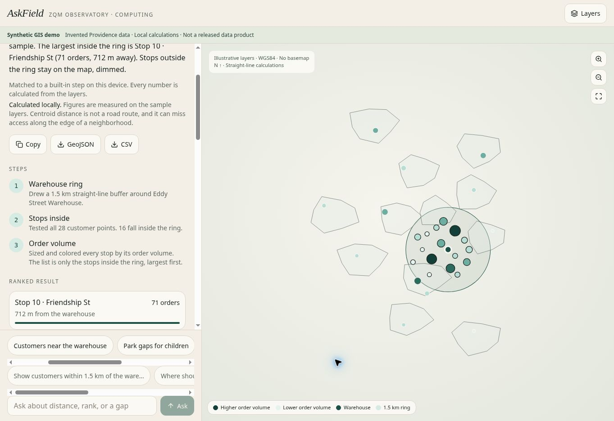

# AskField verification record

This record covers the standalone synthetic demo, not a production service or
an approved data publication. Checks were performed against the source in this PR
and the resulting static build.

## Automated checks

| Check | Observed result |
| --- | --- |
| AskField regression tests | 17 passed; none skipped |
| TypeScript and production build | Passed; one local JS entry, relative asset paths |
| Dependency audit | `npm audit --audit-level=high`: 0 vulnerabilities |
| Existing Observatory Python tests | 149 passed |
| Source-rights register validation | Passed; 7 source decisions; permissions remain as recorded |
| Product-bundle validation | Passed structurally; no published product bundles found |
| New/changed Markdown | Checked with markdownlint; no errors |

The app tests cover known-distance calculations, decimal and inclusive threshold
semantics, complementary within/beyond results, deterministic examples, map/list
IDs, upload limits and malformed inputs, strict Point geometry, export provenance,
CSV formula escaping, and complete uploaded/sample display rows. They do not
verify real-world facts, permission to use uploaded data, or field conditions.

## Browser checks

Both the development app and the built static output rendered at a desktop
viewport of 1363 × 936 CSS pixels. The built output retained its stricter script
policy and executed successfully. No application-origin console errors or
warnings were observed. Browser-extension metadata errors were separate from the
application and were not counted as application failures.

- All five example buttons produced calculated answers. Observed results were
  four senior-distance neighborhoods, 16 of 28 customer stops within 1.5 km,
  four child/park-gap neighborhoods, five neighborhoods below 80% broadband,
  and Mount Hope as the top illustrative facility score.
- A synthetic CSV containing two valid points and one missing latitude loaded
  two points and reported the rejected record. The fixed app listed both points
  and enabled exports.
- A GeoJSON download from the built app was opened and verified to contain both
  uploaded features, `user_supplied_unverified` source labels, and
  `publication_authorized: false`.
- Copy produced a summary that included the synthetic-data notice and blocked
  publication status. Removing the upload cleared the active file and restored
  the default sample. A distance query against the upload also ran locally.
- Layer visibility toggles, Escape dismissal, map selection and detail,
  zoom-in, and fit-all controls responded correctly.
- A Volusia clinic request was declined rather than answered using Providence
  records. No live-source query or production action was performed.

## Remaining verification

Phone-sized browser/device QA is pending. This browser's device emulation was
blocked by its organization policy, and normal window controls did not provide
a narrow viewport. Responsive CSS is present, but no mobile pass is claimed.

The self-hosted Windows CI workflow needs its own exact-head run. Local checks
ran with Node.js 24.22.1; CI selects the Node.js 22 release line. This record is
not evidence that CI completed or that the app was deployed.
