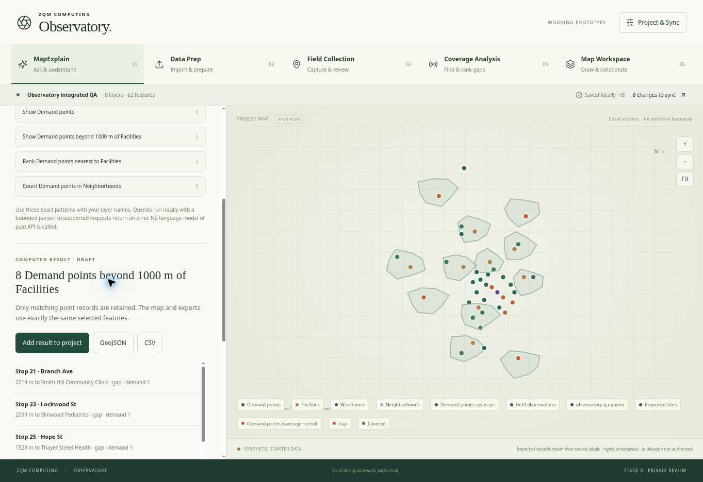
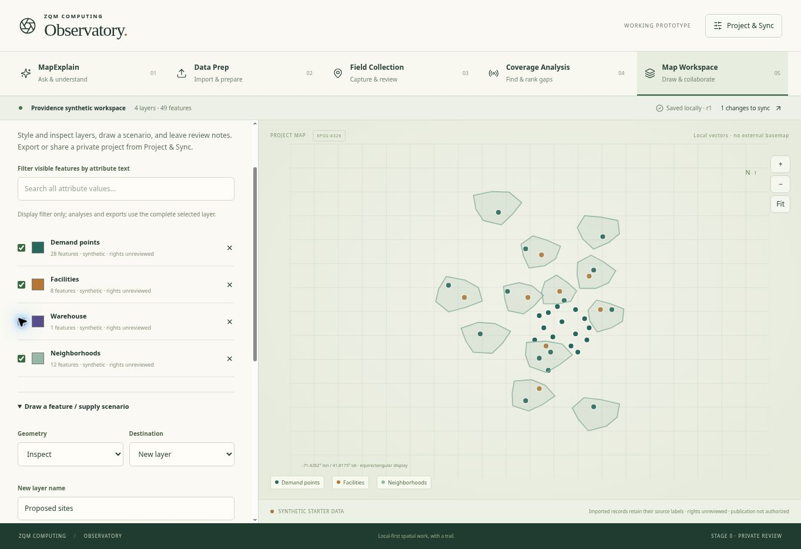
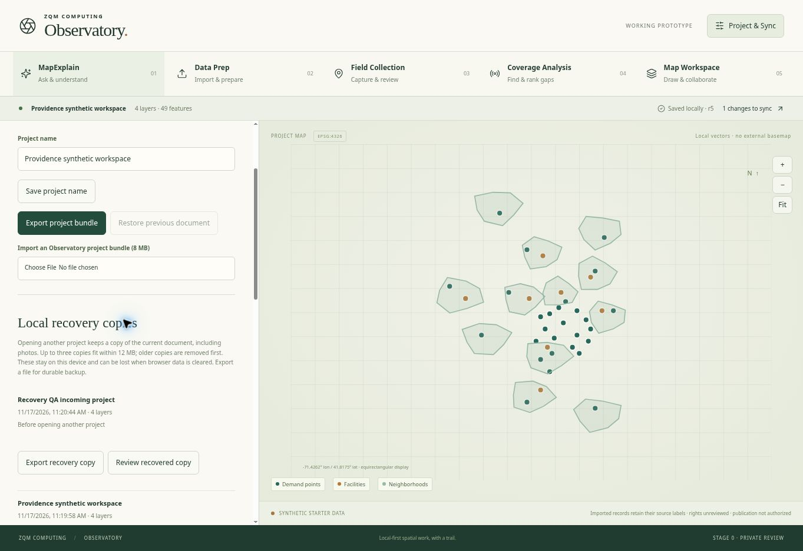
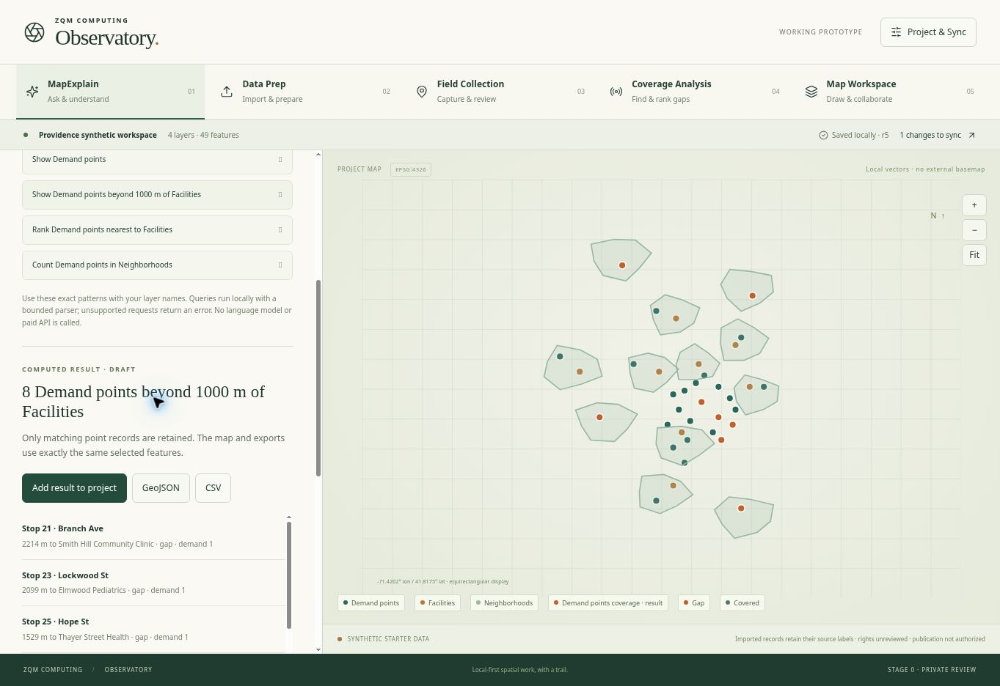

# Integrated Observatory verification

Checks below cover the five-workspace prototype and optional private service on
November 17, 2026. All browser inputs are synthetic. Tests establish technical
behavior, not real-world facts, source rights, or publication approval.

## Automated checks

| Check | Result |
| --- | --- |
| App and build/server regression tests | 85 passed, none skipped; includes durable sync, response contracts, recovery, IndexedDB and seven tooling groups |
| TypeScript and production build | Passed; one bundled local app plus shell-only service worker |
| Private-service/GIS tests | 17 passed, none skipped |
| Optional client/service integration | Passed through the new same-origin development proxy with real loopback HTTP and temporary SQLite; lost-reply retry, fresh local read, later edits and an 8 MB project |
| Frontend dependency audit | Affected dependency chain removed; fresh locked Windows install and full audit pending |
| Existing Observatory governance tests | 167 passed; source-rights register and product structure checks passed |
| Changed Markdown / whitespace | Passed |

The [dependency audit record](../../docs/dependency-audit-2026-11-17.md) records the
original failure and remediation. Functional test/build success does not clear the
security gate; the durable-sync PR remains a draft pending clean CI verification.

Core checks include known geodesic distance, threshold/weight semantics, strict
query rejection, layer-name escaping and overlap, Polygon holes, known Mercator
reprojection, explicit prep fixes, malformed/over-limit CSV rejection, preserved
header choices, draft validation, entity/geometry merge conflicts, acknowledged
operation retention, audit history restoration and CSV formula neutralization.
The older deterministic MapExplain engine remains covered by its regression
suite; the integrated UI uses the new project-aware parser.

Private checks exercise real HTTP authentication, Origin rejection, traversal
rejection, compare-and-swap, concurrent writers, idempotent retries/body mismatch,
retention bounds, schema/rights rejection, deletion of retained history,
authenticated prep/export, known CRS conversion, Shapefile ZIP, GPX and KMZ input,
GEOS multipart repair, unsafe ZIP/XML rejection and a GeoPackage round trip that
preserves polygon holes and attributes. They run against temporary SQLite/files.

Local tests/build passed with Node.js 22.23.5 and 24.22.1; private-service checks
used Python 3.12.14. Parent PR #75 was independently checked at
`181197e9eb3393da0bb672e10a70007a14f74ffd`: 33 app tests and the production build
passed on Node 22.23.5. CI now uses standard hosted Windows 2022 for this public
repository, retaining the same-repository trust guard and read-only permissions.
A private repository falls back to the existing self-hosted Windows pool.
The first hosted run reached the full audit and reproduced the dependency failure,
confirming that runner routing works. CI remains separate from local evidence.

## Observed desktop workflows

The built application was checked in the cloud browser at 1363 × 936 CSS pixels.
The five workspaces rendered within the ZQM Computing / ZQM Observatory identity.
A map-height overflow found during review was corrected; explicit field labels
and map feature keyboard semantics were also improved.

- MapExplain returned eight matching synthetic demand points beyond 1,000 m of
  facilities, with the same selected output shown on the map and in records.
  Saving the answer added its layer to the shared project.
- Coverage with the numeric demand field reported 20 covered and eight gap points,
  weighted gap demand 216, and retained all 28 point records and the formula.
- A two-point CSV was previewed and added through Data Prep, then used by name in
  a MapExplain distance query. It returned zero beyond-threshold records with
  source and method notes, rather than inventing a match.
- A synthetic urgent field observation required follow-up and accepted manual
  coordinates and a JPEG attachment. The photo was resized/re-encoded. Marking
  the record reviewed changed its queue status and persisted after reload.
- A point was drawn on the map and saved as a proposed supply layer. A reviewer
  note was added. Layers, notes, records and revision survived reload.
- A downloaded project bundle was opened and validated separately: eight layers,
  six history entries at that point, reviewed field status, a 46,875-character
  JPEG attachment, and `publication_authorized: false`.
- With the preview origin stopped, reload loaded the cached application and its
  saved records. Another manual observation was saved while the origin remained
  unavailable, then a fresh tab opened the same saved project and queued edit.
  This verifies shell/local-record behavior, not background network sync.
- Two tabs loaded the same revision. Saving a name in the first advanced the
  document. The second tab's stale save was rejected with an explicit conflict;
  its `Stale-tab edit` field remained visible. Reload showed the first tab's name.

## Review corrections — November 17, 2026

Six review findings have targeted corrections:

| Finding | Correction and evidence |
| --- | --- |
| Distance/operator tokens read from layer names | Anchored captures supply the threshold, unit, comparison and ranking direction; regressions cover embedded `500 m`, `2 km`, Beyond and Farthest names |
| Attribute draft copied onto another feature | Drafts carry both layer and feature identity; browser checks confirmed the next feature has an empty draft and disabled Save, with both original demand values intact |
| Independent imports with duplicate names blocked merge review | A naming-conflict preview preserves both layers; explicit local/shared choice controls which retains its name and numbered suffixes avoid existing names |
| Large maps exceeded JavaScript argument limits | Map bounds iterate over coordinates; a valid 300,000-coordinate project returned a finite frame |
| Exported backups exceeded their own restore limit | Project bundles serialize compactly; the large-project regression fits 8 MB and round-trips through validation, while pretty JSON exceeds that limit |
| Fractional demand weights changed score scale | Actual positive maximum is used; relative weights 0.1/0.2 and 1/2 produce the same scores, and all-zero demand remains finite |

The existing 45 tests remain passing, with four additional regression groups.
An associated ranking fix uses the ranking capture rather than searching layer
names. Very large scoring weights also avoid intermediate multiplication overflow.
The new browser check edited only an unsubmitted synthetic draft; switching
between features retained original demand values 42 and 18.

## Workflow continuity corrections — November 17, 2026

- Layer checkbox changes capture the selected value before the asynchronous save.
  Browser QA hid Warehouse, verified its map feature and legend disappeared,
  reloaded and verified the unchecked state persisted, then exercised both toggle
  directions. The feature remains in the project for analysis and export.
- Count inputs follow subject/target order even when both layers contain points
  and polygons. Regressions verify forward and reversed roles and explicit
  exclusion of unrelated geometry types.
- Private conversion output has an 8 MB prepared-output ceiling; the separate
  browser upload ceiling remains 2 MB and private source files remain 4 MB.
  A 2.1 MB attribute survives preparation and project validation without truncation.
- Private projects measure UTF-8 JSON rather than ASCII escape expansion. A
  4.2 MB CJK project saves and reloads over authenticated HTTP. Oversized input
  remains rejected. Receipts from the earlier ASCII-escaped digest remain
  idempotent; reuse with changed content still fails.
- SQLite contexts commit or roll back and always close their handles, with a
  regression checking rollback and closure for portable file cleanup.

## Project replacement recovery — November 17, 2026

Opening another project archives the replaced document in the same IndexedDB
transaction. Thirteen additional regression groups cover immutable copies,
three-copy/12 MB pruning, Unicode byte sizes, fresh recovery identities, 8 MB
boundary behavior, invalid recovery metadata, ordinary saves, competing tab
replacements, synchronous/asynchronous write and deletion rollback,
revision-guarded deletion, and full clear.
A pinned development-only IndexedDB implementation runs these storage tests in
Node; it is not included in the production bundle.

Desktop QA opened a generated synthetic bundle, reloaded, and verified the old
project remained listed. Its exported recovery file was byte-identical to the
pre-replacement export. Reviewing a recovered copy focused the incoming review;
opening it preserved all layers, comments, source/processing notes and the hidden
Warehouse state, added recovery history, assigned a fresh ID, and kept shared
revision 0. The replacement was itself retained, and the restored ID/copies
survived another reload. Publication remained blocked.

The browser deletion confirmation was cancelled; both copies remained. Actual
deletion and storage-failure rollback are verified by automated storage tests.
Physical storage exhaustion/eviction and a corrupted active workspace were not
tested in the browser. Recovery copies are local convenience copies, not durable
backups or a substitute for export.

## Durable private uploads — November 17, 2026

Fourteen additional app regression groups verify that the upload snapshot is
durable before any request, a lost reply or failed local acknowledgement remains
retryable after a fresh database read, competing tabs cannot create independent
requests from one local revision, and later edits stay queued. Tests reject
malformed/foreign responses, incorrect successful content or revision, unsafe
revision numbers, malformed pending metadata and persisted credential fields.
Key-order-only changes no longer create false processing-step merge conflicts.
Readiness checks reject HTML fallback pages, error objects and invalid readiness
claims, rather than reporting that a static preview accepted the private token.

The optional integration command starts an isolated Python service with real
SQLite and uses the production client/controller with an in-memory IndexedDB
implementation. It consumes one accepted response, simulates a lost reply,
reloads local state, and confirms the same request without a duplicate server
revision. A separate push confirms later edits. No token is persisted.

The real HTTP check also uploads an exact 8,000,000-byte synthetic document. A
service regression reproduced the former early rejection and now verifies the
bounded upload wrapper, identical retry and GET, rejection of a document one
byte too large, and unchanged prep request limits. No real source is collected.

The existing trusted Windows workflow includes this integration command after
its Python service checks. Runner completion remains separate from local results.
This does not claim an authenticated browser push/pull/conflict session or a
physical browser crash/eviction test.

## Build and runner troubleshooting — November 17, 2026

The queued job had no assigned runner and required `self-hosted`, `Windows`,
and `X64`. The hosted replacement ran the existing tests and build successfully,
then failed at the unchanged full audit gate. Standard public-repository Windows
runners require no new paid service.

Rolldown and Lightning CSS now build the app without Vite or its affected matcher
dependencies. Both versions were already present in the prior dependency graph;
their native platform packages remain locked. The static styling foundation
retains its license. Seven new test groups cover deterministic hashed output and
precache completeness, safe build destinations, CSS import boundaries/cycles,
offline API exclusion and shell fallback, static preview safety, and same-origin
proxy forwarding/failure behavior. The real 8 MB sync check also uses the proxy.

Desktop browser QA rendered all five workspace panels, ran the distance question
with the expected eight synthetic results, and preserved the existing four-layer,
49-feature project and hidden Warehouse state after reload. With the preview
origin stopped, another reload loaded the new hashed assets from the shell cache
and the same question still ran. The origin was then restarted. This validates
the rebuilt shell, not authenticated browser sync or source permissions.

## Verification limits

- Private HTTP conversion/sync and client merge/acknowledgement logic are tested;
  an authenticated browser push/pull/conflict session is not claimed. No user
  credential was requested for browser QA.
- Actual GPS permissions/accuracy, phone/tablet screens, device camera capture,
  low-storage conditions and long-running offline eviction were not tested.
  Responsive CSS alone is not a mobile pass.
- No general LLM, voice, routing, live-source, public sharing or real-time
  multiplayer integration is implemented or implied.
- No production service was deployed and no real-source product was released.
  Existing rights/privacy/security and product-release gates remain in force.
