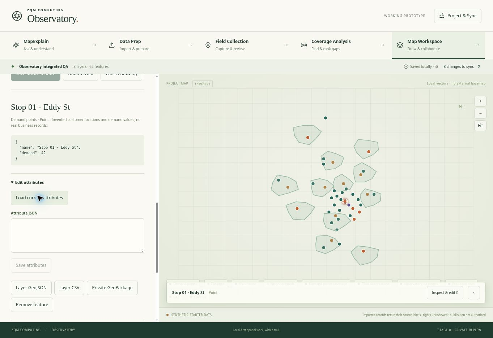

# Integrated Observatory verification

Checks below cover the five-workspace prototype and optional private service on
November 17, 2026. All browser inputs are synthetic. Tests establish technical
behavior, not real-world facts, source rights, or publication approval.

## Automated checks

| Check | Result |
| --- | --- |
| TypeScript/core regression tests | 49 passed, none skipped; includes the latest three parent-PR fixes |
| TypeScript and production build | Passed; one bundled local app plus shell-only service worker |
| Private-service/GIS tests | 12 passed, none skipped |
| Frontend dependency audit | 0 vulnerabilities reported by `npm audit --audit-level=high` |
| Existing Observatory governance tests | 149 passed; source-rights register and product structure checks passed |
| Changed Markdown / whitespace | Passed |

Core checks include known geodesic distance, threshold/weight semantics, strict
query rejection, layer-name escaping and overlap, Polygon holes, known Mercator
reprojection, explicit prep fixes, malformed/over-limit CSV rejection, preserved
header choices, draft validation, entity/geometry merge conflicts, acknowledged
operation retention, audit history restoration and CSV formula neutralization.
The older deterministic MapExplain engine remains covered by its regression
suite; the integrated UI uses the new project-aware parser.

Private checks exercise real HTTP authentication, Origin rejection, traversal
rejection, compare-and-swap, concurrent writers, idempotent retries/body mismatch,
retention bounds, schema/rights rejection, deletion of retained history,
authenticated prep/export, known CRS conversion, Shapefile ZIP, GPX and KMZ input,
GEOS multipart repair, unsafe ZIP/XML rejection and a GeoPackage round trip that
preserves polygon holes and attributes. They run against temporary SQLite/files.

Local tests/build passed with Node.js 22.23.5 and 24.22.1; private-service checks
used Python 3.12.14. Parent PR #75 was independently checked at
`181197e9eb3393da0bb672e10a70007a14f74ffd`: 33 app tests and the production build
passed on Node 22.23.5. CI uses the trusted self-hosted Windows runner and remains
separate evidence. A code merge does not establish passing CI or deployment.

## Observed desktop workflows

The built application was checked in the cloud browser at 1363 × 936 CSS pixels.
The five workspaces rendered within the ZQM Computing / ZQM Observatory identity.
A map-height overflow found during review was corrected; explicit field labels
and map feature keyboard semantics were also improved.

- MapExplain returned eight matching synthetic demand points beyond 1,000 m of
  facilities, with the same selected output shown on the map and in records.
  Saving the answer added its layer to the shared project.
- Coverage with the numeric demand field reported 20 covered and eight gap points,
  weighted gap demand 216, and retained all 28 point records and the formula.
- A two-point CSV was previewed and added through Data Prep, then used by name in
  a MapExplain distance query. It returned zero beyond-threshold records with
  source and method notes, rather than inventing a match.
- A synthetic urgent field observation required follow-up and accepted manual
  coordinates and a JPEG attachment. The photo was resized/re-encoded. Marking
  the record reviewed changed its queue status and persisted after reload.
- A point was drawn on the map and saved as a proposed supply layer. A reviewer
  note was added. Layers, notes, records and revision survived reload.
- A downloaded project bundle was opened and validated separately: eight layers,
  six history entries at that point, reviewed field status, a 46,875-character
  JPEG attachment, and `publication_authorized: false`.
- With the preview origin stopped, reload loaded the cached application and its
  saved records. Another manual observation was saved while the origin remained
  unavailable, then a fresh tab opened the same saved project and queued edit.
  This verifies shell/local-record behavior, not background network sync.
- Two tabs loaded the same revision. Saving a name in the first advanced the
  document. The second tab's stale save was rejected with an explicit conflict;
  its `Stale-tab edit` field remained visible. Reload showed the first tab's name.

## Review corrections — November 17, 2026

Six review findings have targeted corrections:

| Finding | Correction and evidence |
| --- | --- |
| Distance/operator tokens read from layer names | Anchored captures supply the threshold, unit, comparison and ranking direction; regressions cover embedded `500 m`, `2 km`, Beyond and Farthest names |
| Attribute draft copied onto another feature | Drafts carry both layer and feature identity; browser checks confirmed the next feature has an empty draft and disabled Save, with both original demand values intact |
| Independent imports with duplicate names blocked merge review | A naming-conflict preview preserves both layers; explicit local/shared choice controls which retains its name and numbered suffixes avoid existing names |
| Large maps exceeded JavaScript argument limits | Map bounds iterate over coordinates; a valid 300,000-coordinate project returned a finite frame |
| Exported backups exceeded their own restore limit | Project bundles serialize compactly; the large-project regression fits 8 MB and round-trips through validation, while pretty JSON exceeds that limit |
| Fractional demand weights changed score scale | Actual positive maximum is used; relative weights 0.1/0.2 and 1/2 produce the same scores, and all-zero demand remains finite |

The existing 45 tests remain passing, with four additional regression groups.
An associated ranking fix uses the ranking capture rather than searching layer
names. Very large scoring weights also avoid intermediate multiplication overflow.
The new browser check edited only an unsubmitted synthetic draft; switching
between features retained original demand values 42 and 18.

## Verification limits

- Private HTTP conversion/sync and client merge/acknowledgement logic are tested;
  an authenticated browser push/pull/conflict session is not claimed. No user
  credential was requested for browser QA.
- Actual GPS permissions/accuracy, phone/tablet screens, device camera capture,
  low-storage conditions and long-running offline eviction were not tested.
  Responsive CSS alone is not a mobile pass.
- No general LLM, voice, routing, live-source, public sharing or real-time
  multiplayer integration is implemented or implied.
- No production service was deployed and no real-source product was released.
  Existing rights/privacy/security and product-release gates remain in force.
